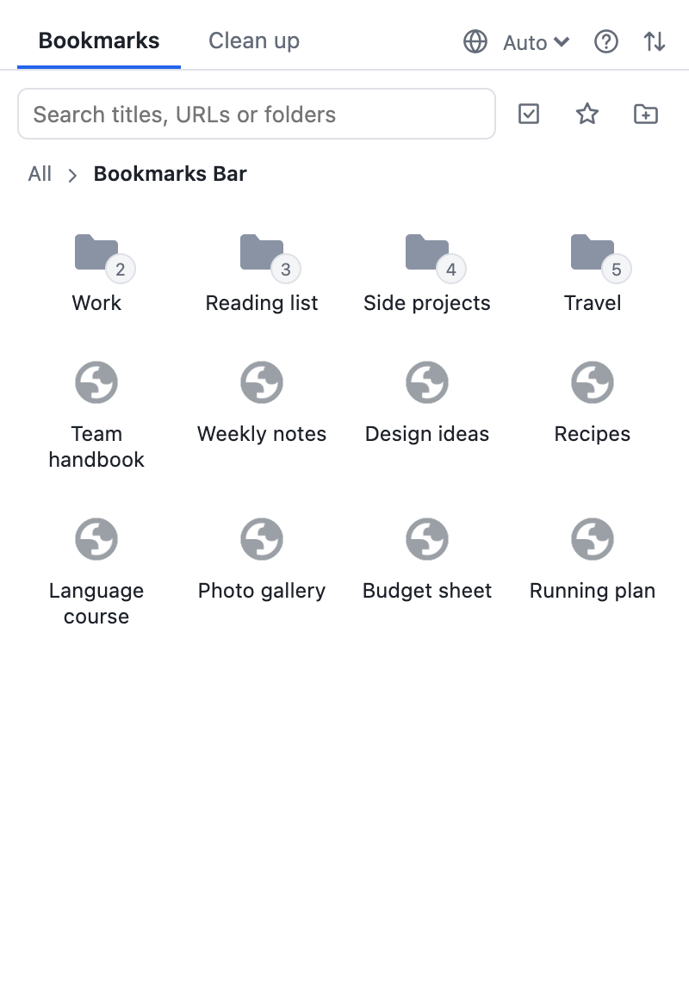
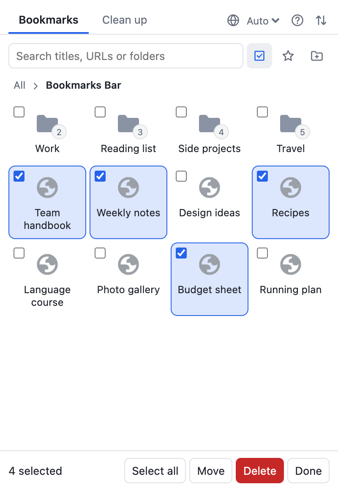
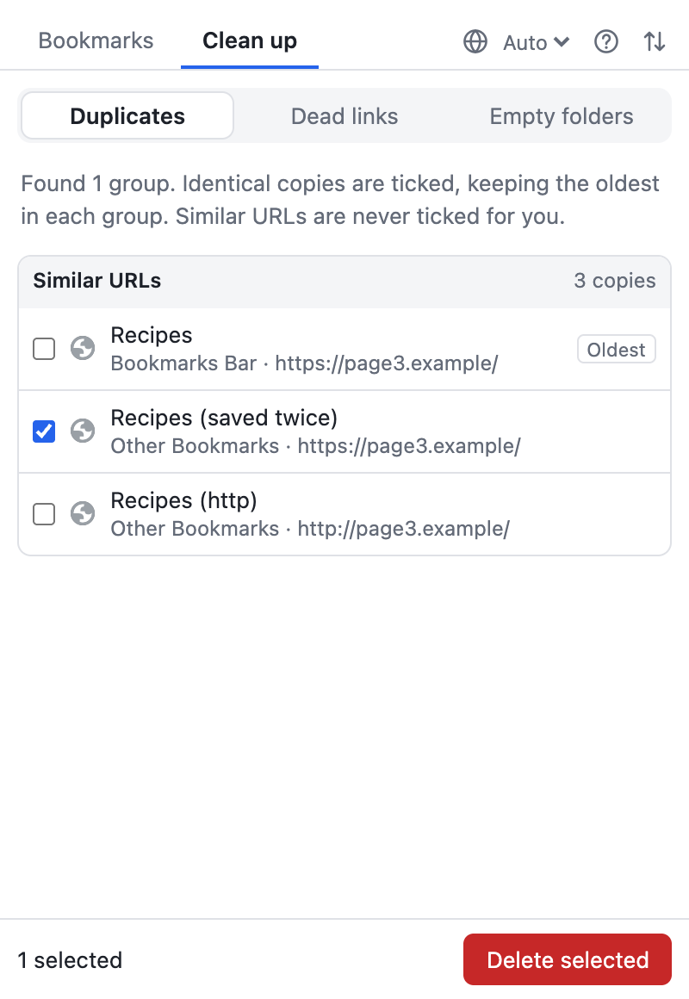

<div align="center">
  
  <h1>Bookmark Butler</h1>
  <p><em>A Chrome extension to search, organize and clean up your bookmarks from a popup</em></p>
  <p>English · <a href="README_CN.md">中文</a></p>
  <p>
    <a href="https://github.com/shixiaozhong/bookmark-butler/releases/latest">Download</a> ·
    <a href="#quick-start">Quick start</a> ·
    <a href="#faq">FAQ</a>
  </p>
  <a href="https://github.com/shixiaozhong/bookmark-butler/actions/workflows/ci.yml"></a>
  <a href="https://github.com/shixiaozhong/bookmark-butler/releases/latest"></a>
  
  
  <a href="LICENSE"></a>
</div>

<br />

<p align="center">
  
  
  
</p>

## Why

Bookmarks pile up over the years: the same page saved in three folders, links that stopped working long ago, folders left empty by the last tidy-up. Finding these by hand means opening one folder after another and clicking links to see what still loads.

Bookmark Butler finds them for you and leaves the decision to you. It works directly on Chrome's own bookmarks, so there's nothing to import and nothing to keep in sync, and it has no account, no analytics and no server.

## Quick start

1. Download `bookmark-butler-*.zip` from the [latest release](https://github.com/shixiaozhong/bookmark-butler/releases/latest) and unzip it. Keep the folder, because Chrome loads the extension from it.
2. Open `chrome://extensions` and turn on **Developer mode**.
3. Click **Load unpacked** and choose the unzipped folder.
4. Pin the extension to the toolbar and click its icon.

To update, download the new version, replace the folder's contents, then click the reload button on the extension's card.

> This manages your real bookmarks, and with Chrome Sync on, changes reach your other devices too. Before a big cleanup, you can export a backup from the import and export page.

## Features

- **Grid view**: browse bookmarks as icons, open folders in place, and go back up with the path at the top
- **Search**: by title, URL or folder, with several keywords at once
- **Address bar search**: type `b`, a space and a keyword, without opening the popup
- **Drag and drop**: reorder, drop into a folder, hover to open one mid-drag, or drop on the path to move up a level
- **Multi-select**: move, delete or drag many items together, picked across folders and search results
- **Duplicate cleanup**: identical copies are ticked for you, keeping the oldest in each group; URLs that only look similar are never ticked for you
- **Dead link check**: runs in the background and keeps going if you close the popup; results are sorted into dead, can't connect and not sure, and nothing is ticked for you
- **Empty folder cleanup**: finds folders with no bookmarks anywhere inside
- **Undo**: bring back the latest deletion for 10 minutes, or undo a move right after making it
- **Import and export**: the standard bookmark file used by Chrome, Edge, Firefox and Safari; imports go into a new folder and skip URLs you already have
- **English and Chinese**: follows Chrome or your choice in the popup, with light and dark themes that follow your system

## Usage

Click the extension icon, or press `?` in the popup to see this list.

| Action | macOS | Windows / Linux |
|---|---|---|
| Open the first search result | `Enter` | `Enter` |
| Move from search to the list | `↓` | `↓` |
| Move between items | Arrow keys | Arrow keys |
| Open a bookmark or folder | `Enter` | `Enter` |
| Go up a level | `Delete` | `Backspace` |
| Open a bookmark in the background | `⌘` + click | `Ctrl` + click |
| Change an item's position | `⌥` + arrow keys | `Alt` + arrow keys |
| Select or deselect, in multi-select | `Space` | `Space` |
| Select a range, in multi-select | `Shift` + click | `Shift` + click |
| Close a dialog, leave multi-select or clear the search | `Esc` | `Esc` |

In the address bar, type `b`, then a space, then your keywords.

## Design principles

- **Your bookmarks stay in Chrome**: the extension keeps no copy, so what you see here and in Chrome is always the same
- **You make the call**: only exact copies are ticked in advance; anything that could be wrong waits for you
- **Mistakes can be undone**: deletions and moves can be reversed, and deleting a folder or several items asks first
- **Nothing is sent to the developer**: no accounts, no analytics and no server; the dead link check only runs when you start it
- **No dependencies, no build**: plain HTML, CSS and JavaScript that Chrome loads as it is

## FAQ

- **Why does it ask for access to all websites?** Bookmarks can point anywhere, so checking for dead links has to be able to request any address. Requests are only made when you start a check, they carry no cookies or logins, and private network addresses are skipped. The same access lets it fill in the current page when you save it.
- **Does "can't connect" mean a link is dead?** Not necessarily. The site may be gone, or just not reachable from your network or proxy. Use the button beside the result to open it and check before deleting.
- **What can't the dead link check catch?** Pages that respond normally while showing "not found", such as a redirect to the home page. Pages behind a login may show up as "not sure".
- **Why do restored or imported bookmarks show a new date added?** Chrome doesn't let extensions set that date. It also affects which copy counts as the oldest when finding duplicates.
- **Why not install it from the Chrome Web Store?** It isn't listed yet. Because it's loaded in developer mode, it doesn't update by itself, and Chrome may show a reminder about developer mode extensions.
- **Why is the name in `chrome://extensions` always English?** Chrome reads it from the manifest, so it's kept the same everywhere. The language setting covers the popup and the import and export page.
- **Does it work in Edge or Brave?** They are built on the same engine, so it may well work, but it has only been tested in Chrome.

## Development

You need [Node](https://nodejs.org) 22.2+ to run the scripts; there's nothing to install. To try your changes, load this folder with **Load unpacked** and click the reload button on the extension's card after editing.

```bash
npm test            # unit tests
npm run package     # tests, version check, then dist/bookmark-butler-<version>.zip
npm run bump minor  # patch, minor, major or an exact version, in both version files
npm run icons       # redraw the icons
```

```
background.js   # address bar search and the dead link check, which outlives the popup
lib/            # logic that doesn't touch the page: URLs, duplicates, link checks, drag rules, file format
popup/          # the popup
transfer/       # the import and export page
_locales/       # interface text in English and Chinese
scripts/        # packaging, version bumps and icons
tests/          # unit tests
```

[CI](.github/workflows/ci.yml) runs the tests and builds the zip on Node 22 and 24 for every push.

To release a version, bump it, tag it and push. [A workflow](.github/workflows/release.yml) then publishes a GitHub Release with the zip, and stops if the tag doesn't match the version.

```bash
npm run bump minor
git commit -am "Bump version to 0.3.0"
git tag v0.3.0
git push && git push --tags
```

Notes for a future Chrome Web Store listing are in [CHROMEWEBSTORE.md](CHROMEWEBSTORE.md).

## License

[MIT](LICENSE). Feel free to use it and to contribute.
