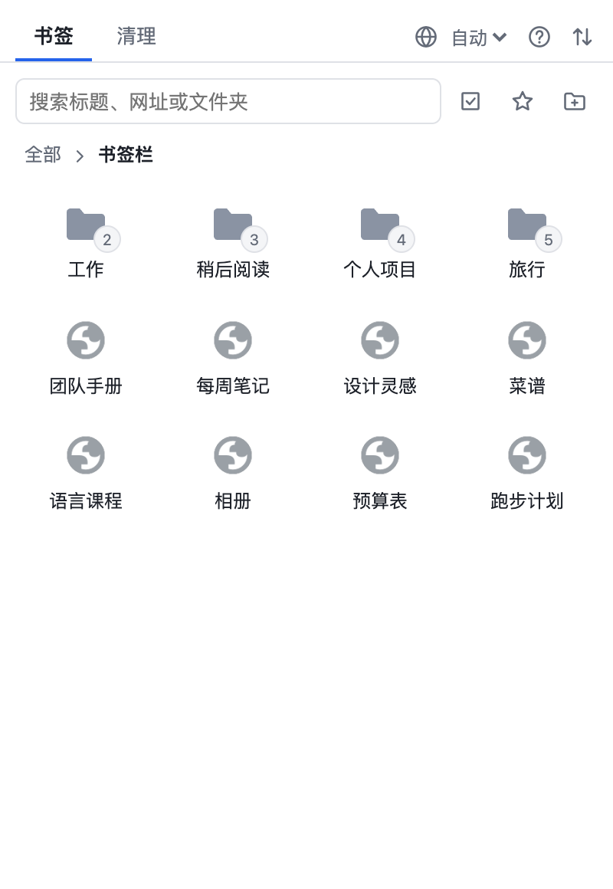
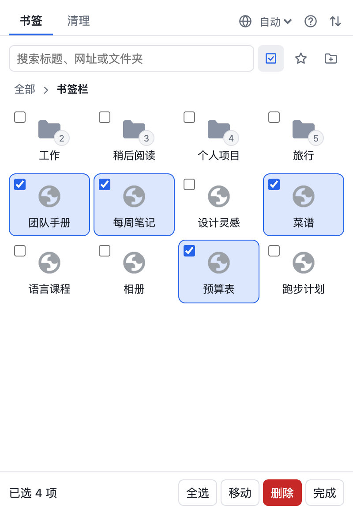
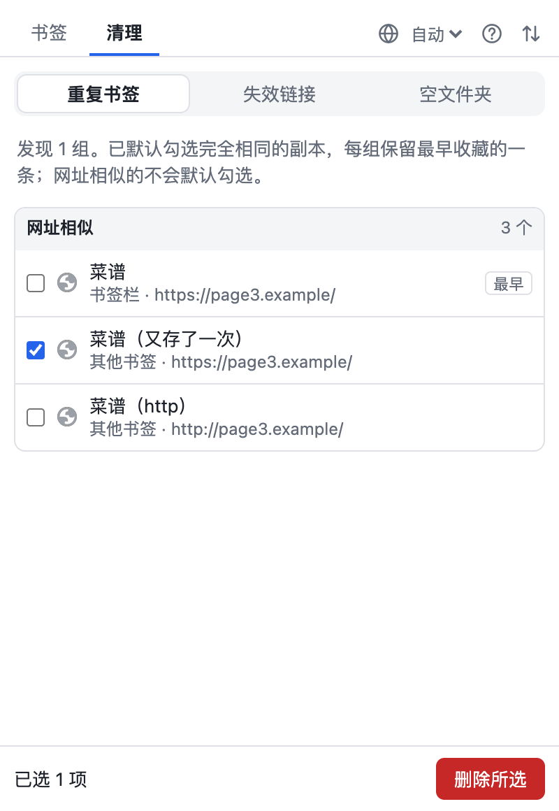

<div align="center">
  
  <h1>书签管家</h1>
  <p><em>在弹窗里搜索、整理和清理书签的 Chrome 插件</em></p>
  <p><a href="README.md">English</a> · 中文</p>
  <p>
    <a href="https://github.com/shixiaozhong/bookmark-butler/releases/latest">下载</a> ·
    <a href="#快速开始">快速开始</a> ·
    <a href="#常见问题">常见问题</a>
  </p>
  <a href="https://github.com/shixiaozhong/bookmark-butler/actions/workflows/ci.yml"></a>
  <a href="https://github.com/shixiaozhong/bookmark-butler/releases/latest"></a>
  
  
  <a href="LICENSE"></a>
</div>

<br />

<p align="center">
  
  
  
</p>

## 为什么

书签用久了就会越积越多：同一个网页存在三个文件夹里，很多链接早就打不开了，上次整理还留下一堆空文件夹。手动清理只能一个个文件夹翻，一个个链接点开看。

书签管家帮你把它们找出来，删不删由你决定。它直接操作 Chrome 自己的书签，不用导入，也没有另一份数据要同步；没有账号、没有统计分析，也没有服务器。

## 快速开始

1. 到[最新版本](https://github.com/shixiaozhong/bookmark-butler/releases/latest)下载 `bookmark-butler-*.zip` 并解压。请保留解压后的文件夹，Chrome 会从这里加载插件。
2. 打开 `chrome://extensions`，开启右上角的**开发者模式**。
3. 点**加载已解压的扩展程序**，选择解压后的文件夹。
4. 把插件固定到工具栏，点图标打开。

更新时，下载新版本并替换文件夹内容，再点插件卡片上的刷新按钮。

> 这里操作的是你真实的书签。开了 Chrome 同步的话，改动也会同步到其他设备。大规模清理前，可以先在导入导出页面备份一份。

## 功能

- **网格浏览**：以图标方式浏览书签，点文件夹进入，用顶部路径返回
- **搜索**：按标题、网址或文件夹查找，支持多个关键词
- **地址栏搜索**：输入 `b`、空格和关键词，不用打开弹窗
- **拖拽整理**：调整顺序、放进文件夹，拖动时停留可以进入文件夹，拖到路径上可以移到上层
- **多选和批量操作**：一次移动、删除或拖动多项，可以跨文件夹、跨搜索结果选择
- **清理重复**：完全相同的副本默认勾选，每组保留最早收藏的一条；只是相似的网址不会默认勾选
- **检测失效链接**：在后台运行，关闭弹窗也不会中断；结果分为已失效、无法连接和不确定三类，都不会默认勾选
- **清理空文件夹**：找出里面没有任何书签的文件夹
- **撤销**：10 分钟内可以恢复最近一次删除，移动后也可以马上撤销
- **导入导出**：使用 Chrome、Edge、Firefox、Safari 通用的书签文件；导入的内容放进新文件夹，并跳过已有的网址
- **中文和英文**：跟随 Chrome，也可以在弹窗里手动选择；明暗主题跟随系统

## 用法

点工具栏上的插件图标；在弹窗里按 `?` 也能看到下面这份列表。

| 操作 | macOS | Windows / Linux |
|---|---|---|
| 打开第一条搜索结果 | `回车` | `回车` |
| 从搜索框进入列表 | `↓` | `↓` |
| 在图标之间移动 | 方向键 | 方向键 |
| 打开书签或进入文件夹 | `回车` | `回车` |
| 返回上一层 | `Delete` | `Backspace` |
| 在后台打开书签 | `⌘` + 点击 | `Ctrl` + 点击 |
| 调整图标的位置 | `⌥` + 方向键 | `Alt` + 方向键 |
| 勾选或取消勾选（多选模式） | `空格` | `空格` |
| 连续选择（多选模式） | `Shift` + 点击 | `Shift` + 点击 |
| 关闭对话框、退出多选或清空搜索 | `Esc` | `Esc` |

在地址栏输入 `b`、空格，再输入关键词，就能搜索书签。

## 设计原则

- **书签留在 Chrome 里**：插件不保存副本，这里看到的和 Chrome 里的始终一样
- **由你决定**：只有完全相同的副本才会默认勾选，可能判断错的内容都等你确认
- **操作可以撤销**：删除和移动都能撤销，删除文件夹或多项内容前还会先确认
- **不向开发者发送任何数据**：没有账号、没有统计分析，也没有服务器；失效链接检测只在你点击开始后才运行
- **零依赖、无需构建**：纯 HTML、CSS 和 JavaScript，Chrome 直接加载

## 常见问题

- **为什么要访问所有网站的权限？** 书签可能指向任何网址，检测失效链接就需要能访问这些地址。只有你点击开始检测后才会发起请求，请求不带 Cookie 和登录状态，内网地址也会跳过。收藏当前页时，也用这个权限读取页面地址和标题。
- **“无法连接”就是链接失效了吗？** 不一定。可能是网站已下线，也可能只是当前网络或代理访问不了。删除前可以点结果旁边的按钮打开确认。
- **失效检测有什么查不出来？** 页面失效但仍返回正常响应的情况，比如跳转到首页。需要登录的页面可能显示为“不确定”。
- **为什么恢复或导入的书签，添加时间变了？** Chrome 不允许插件设置这个时间。这也会影响查重时哪条算“最早收藏”。
- **为什么不从 Chrome 商店安装？** 目前还没有上架。用开发者模式加载的插件不会自动更新，Chrome 也可能提示你正在运行开发者模式的扩展程序。
- **为什么 `chrome://extensions` 里的名称总是英文？** Chrome 从 manifest 读取这个名称，所以在各处保持一致。语言设置作用于弹窗和导入导出页面。
- **Edge 或 Brave 能用吗？** 它们和 Chrome 使用同样的内核，很可能可以用，但目前只在 Chrome 上测试过。

## 开发

运行脚本需要 [Node](https://nodejs.org) 22.2+，不用安装任何依赖。想试改动的话，用**加载已解压的扩展程序**加载本目录，改完代码后点插件卡片上的刷新按钮。

```bash
npm test            # 单元测试
npm run package     # 跑测试、检查版本号，再生成 dist/bookmark-butler-<版本号>.zip
npm run bump minor  # 升版本号（patch、minor、major 或具体版本），同时改两处
npm run icons       # 重新生成图标
```

```
background.js   # 地址栏搜索，以及在弹窗关闭后继续运行的失效链接检测
lib/            # 不涉及页面的逻辑：网址、重复检测、链接判定、拖拽规则、文件格式
popup/          # 弹窗
transfer/       # 导入导出页面
_locales/       # 中英文界面文字
scripts/        # 打包、升版本号和生成图标
tests/          # 单元测试
```

每次推送，[CI](.github/workflows/ci.yml) 都会在 Node 22 和 24 上跑测试并打包。

发布新版本时，升版本号、打标签并推送。[发布流程](.github/workflows/release.yml)会自动创建附带 zip 的 GitHub Release；标签和版本号不一致时会停止发布。

```bash
npm run bump minor
git commit -am "Bump version to 0.3.0"
git tag v0.3.0
git push && git push --tags
```

上架 Chrome 商店的资料在 [CHROMEWEBSTORE.md](CHROMEWEBSTORE.md)。

## 许可证

[MIT](LICENSE)。欢迎使用，也欢迎贡献。
